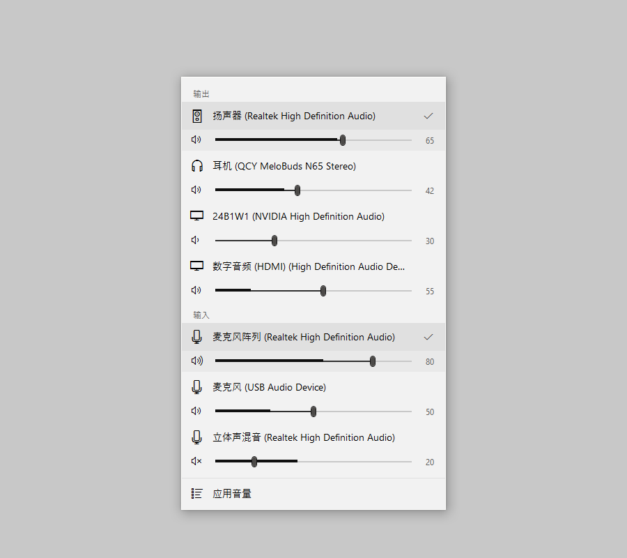
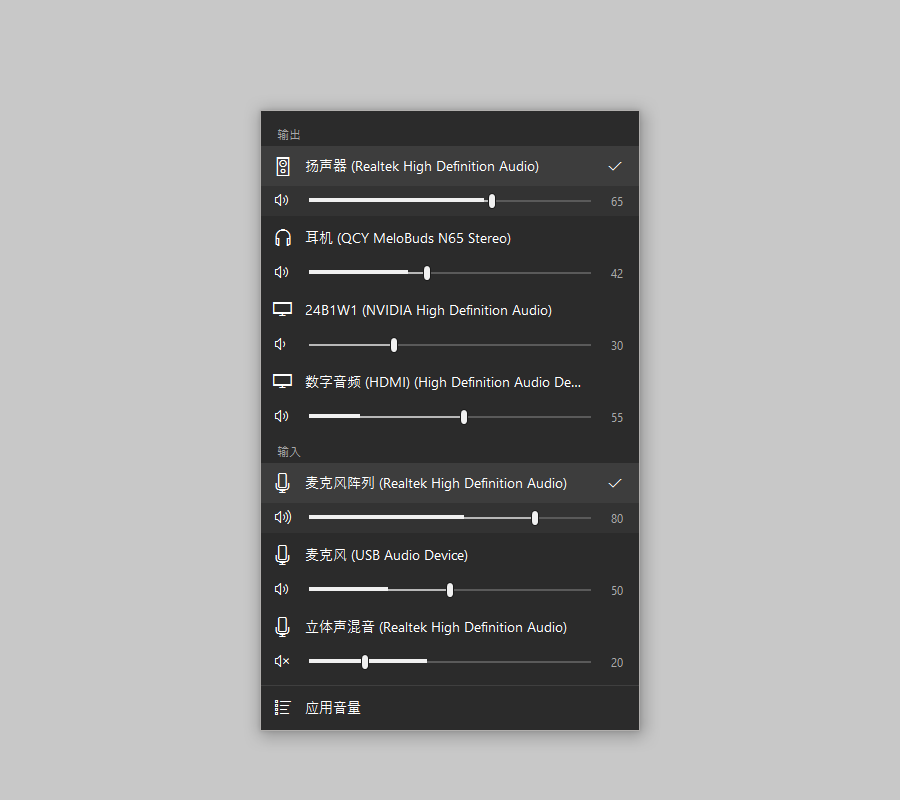
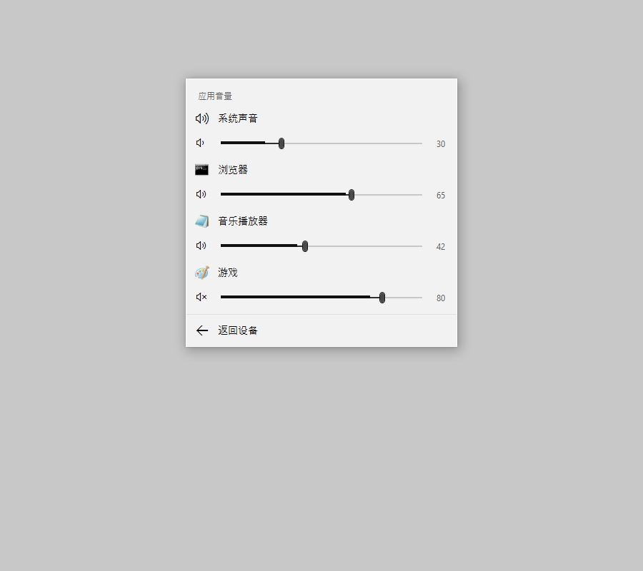
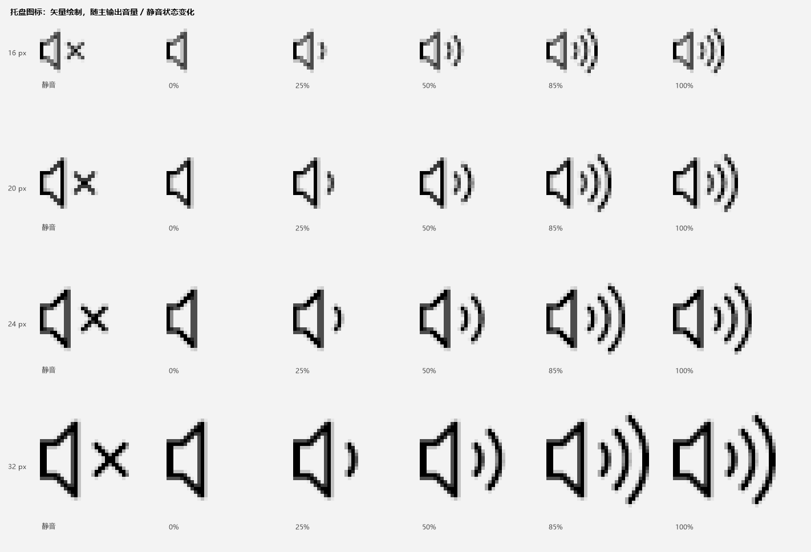

# 音频设备切换器（AudioSwitch）v1.6.4

[](https://github.com/IzuhaRui/AudioSwitch/releases/latest)
[](LICENSE)
[](#运行要求)
[](src/AudioSwitch.csproj)

> **📥 下载**：到 [**Releases**](https://github.com/IzuhaRui/AudioSwitch/releases/latest) 下载 `AudioSwitch-1.6.4-win10.zip`，解压后双击 `AudioSwitch.exe` 即可使用（免安装、免管理员权限、Win10 自带运行库）。

一个 Windows 10 原生风格的任务栏通知区域小工具：**左键单击右下角的托盘图标**，弹出设备面板，列出当前所有**音响（播放设备）**和**麦克风（录音设备）**，单击即可切换系统默认设备；**每个设备下方都有独立音量条和静音按钮**，可连续切换音响、麦克风而面板不会关闭。

界面按 Windows 10 系统浮出面板（音量/网络面板）的样式实现：**原生 DWM 投影阴影**、浅色/深色任务栏自适应、系统强调色、Segoe MDL2 Assets 图标、Segoe UI + 微软雅黑字体、原生风格音量滑块。







---


## 功能

### 设备切换

- **通知区域图标**：左键单击打开/关闭设备面板；右键单击弹出菜单。
- **设备面板**：分「输出」和「输入」两组，列出所有当前可用的音响、耳机、HDMI、麦克风等设备。当前默认设备分成**上下两个紧贴的高亮区域**：设备名称区深一些、音量区浅一些（浅色任务栏用更深的底色，深色任务栏用更浅的底色），两区之间没有空隙，配合 ✓ 一眼就能看出当前设备。
- **隐藏不用的设备**：在面板里**右键单击**某个音响/麦克风的名称，选择「隐藏此设备」即可把它从面板列表里移除（选择会保存，重启后仍然隐藏）。想恢复时右键任务栏托盘图标 → **「取消所有隐藏」** 即可一次显示全部设备。
- **单击切换、面板不关闭**：v1.2 起点击设备后面板保持打开，方便连续切换音响和麦克风；切换后 ✓ 会自动移动，列表顺序保持稳定不跳动。
- **关闭方式**：再次点击托盘图标、按 `Esc`、或点击面板以外的任意位置。
- **自动刷新**：插拔设备、连接蓝牙耳机等变化会通过系统音频通知自动更新列表和托盘提示。

### 每设备音量与静音（v1.2 新增）

- 每个音响 / 麦克风下方都有一条**独立音量条**（参照 Windows 10 音量调节样式：2px 细轨道 + 深色已调音量线 + 4px 实时电平条 + 8×16 胶囊滑块，右侧显示 0~100 数值），在音量条的**任意位置按下并拖动**即可调节该设备的音量（对默认设备即时生效）。
- **实时播放电平表（已整合进音量条）**：音量条上方会随该设备当前播放/采集的声音大小出现一段**4px 深色电平条**（比 2px 细音量条略粗一点，快速起、缓慢落），只加粗音量条的上半部分、两端直角；看它有没有动就知道当前有没有声音在播放。调节音量时右侧数字同步显示当前音量。音量条两端做了限位收缩，调到 0% / 100% 时滑块会把轨道两端完全盖住，不会漏出一截。
- 音量条左侧是 **Windows 默认的喇叭图标**，会随音量大小动态变化（静音 / 无波浪 / 1～3 道声波）；**单击即可一键静音 / 取消静音**。图标全部由矢量的 Segoe MDL2 Assets 字体绘制，任意缩放/高 DPI 下都清晰。
- 面板打开期间会定时同步外部音量变化（例如键盘媒体键、其他程序调整音量）。
- **音量调节提示音**：调节主输出音量后播放 Windows 自带的 “Default Beep”（和音量键的“叮”声一致，尊重系统声音方案）。**拖动音量条时只在松开鼠标后响一次**，不会拖动过程中连续响；右键菜单「音量调节提示音」可随时关闭。
- 任务栏悬停提示显示当前默认输出设备；面板内音量条提示显示具体百分比。
- 键盘操作：方向键 ↑/↓ 选择设备，Enter 切换，Esc 关闭；Tab 可移动到音量条后用左右方向键调节。

### 应用音量页（v1.6.0 新增）

- 面板底部的「应用音量」按钮可把整个页面切换到**每个应用单独调音量**的页面（再点「返回设备」切回）。
- 应用页按应用分组列出当前正在使用音频的应用（含「系统声音」），显示**应用图标**，每个应用有独立音量条、静音按钮、百分比和**实时电平表**，样式与设备页一致。
- 切换后会自动记住当前页面（`HKCU\\Software\\AudioSwitch\\FlyoutPage`），下次打开面板直接回到上次的页面。
- 应用音量仅作用于当前默认输出设备上的会话；应用退出/开始播放声音后列表会自动刷新。

### 其他

- **右键菜单**：打开切换面板 / 刷新设备 / 声音设置 / 声音控制面板 / 开机自动启动 / 音量调节提示音 / 取消所有隐藏 / 退出。
- **深色主题菜单**：设备名称的右键菜单也会跟随浅色/深色任务栏切换背景与文字颜色，不再固定使用系统浅色菜单。
- **动态托盘图标（v1.2.2）**：任务栏图标使用 Windows 默认音量喇叭形态，**实时显示当前主输出设备的音量档位（0 / 1～3 道声波）和静音状态**，随音量、媒体键、默认设备切换自动更新；悬停提示同时显示当前音量百分比。
- **原生视觉**：DWM 原生窗口投影阴影、跟随系统浅色/深色任务栏与强调色、1px 边框、分隔线；**所有界面图标均为矢量字形/矢量绘制**，托盘图标按当前系统的实际图标尺寸（16/20/24/32…）实时渲染，多分辨率/高 DPI 下都清晰。
- **单实例**：重复运行只会唤出已有实例的面板；崩溃残留的单实例锁会自动恢复。
- **开机自动启动**：右键菜单一键开关（写入当前用户注册表 Run 项，无需管理员权限）。
- **无需安装**：Windows 10 自带 .NET Framework 4.8 即可运行，免安装、免管理员权限。

托盘图标（矢量绘制，随主输出音量 / 静音状态变化）：



## 极简说明

只想快速上手？直接看 **[使用说明-极简版.txt](使用说明-极简版.txt)**（约 20 行）：启动方式、左键/右键托盘、切换设备、调音量/静音、隐藏与恢复、关闭。

## 运行要求

- Windows 10（1607 及以上，推荐 1903/22H2）。程序使用 .NET Framework 4.7.1 编译，Windows 10 自带的 4.8 运行库可直接运行，**不需要安装任何运行时**。
- 无需管理员权限。

## 使用方法

1. 双击 `AudioSwitch.exe`。
2. 启动后程序只出现在任务栏右下角的通知区域：
   - 如果没看到图标，点击任务栏右下角的 **^** 展开隐藏的图标；可以把它**拖到任务栏上**固定显示。
   - 首次运行会弹出通知提示图标位置。
3. **左键单击**图标 → 弹出设备面板。
4. 单击设备名称行 → 切换默认设备（**面板保持打开**，✓ 移动）。
5. 在设备下方的音量条**任意位置按下并拖动** → 调节该设备音量（不必对准圆点）；拖动/播放时音量条上半部分会显示随声音跳动的实时电平条；单击左侧喇叭图标 → 静音/取消静音。
6. 在设备名称上**单击右键** → 「隐藏此设备」可隐藏不用的设备；恢复：右键托盘图标 →「取消所有隐藏」。
7. 调节主输出音量后会播放 Windows 自带的音量提示音；拖动音量条时**松开鼠标后才响一次**，不需要时可在托盘右键菜单关闭「音量调节提示音」。
8. 面板底部「应用音量」→ 切换到单应用音量页；在应用页底部点「返回设备」回到设备页（页面选择会被记住）。
9. 关闭面板：再次单击托盘图标、按 `Esc`、或点击面板以外的任意位置。

## 常见问题

| 现象 | 原因 / 解决 |
| --- | --- |
| 双击后没有任何反应，也没有图标 | 检查是否从 AI 助手/沙箱里“打开”了程序。用资源管理器双击运行；如果弹出提示框，按提示操作。 |
| 任务栏上看不到图标 | Win10 默认把新图标放进隐藏区：点任务栏右下角 **^** 找到图标，可拖到任务栏固定。 |
| 提示“无法创建任务栏通知区域图标” | 确认 `explorer.exe`（Windows 资源管理器）正在运行；重新用资源管理器双击启动。 |
| SmartScreen 提示“Windows 已保护你的电脑” | 程序未签名。点「更多信息」→「仍要运行」。 |
| 音量条拖动没有反应 | 该设备可能不支持软件音量控制（部分虚拟声卡），此时音量条会置灰。 |
| 开机自动启动设置失败 | 安全软件可能拦截了 `HKCU\Software\Microsoft\Windows\CurrentVersion\Run` 写入，请放行后重试。 |
| 面板里的设备很少 | 只显示当前处于“活动”状态的设备；蓝牙耳机未连接时不会出现（与 Windows 音量面板一致）。 |

日志文件：`%LOCALAPPDATA%\AudioSwitch\AudioSwitch.log`（排错用）。

## 目录结构

```
AudioSwitch/
├─ dist/                        ← 编译输出目录（本版本成品：AudioSwitch.exe + 配置 + 使用说明）
├─ src/                         ← C# / WPF 源码（分层模块化）
│  ├─ App/                      ← 应用层：入口、单实例、启动模式、依赖装配（AppHost）、诊断命令
│  ├─ Audio/                    ← 音频域：设备服务、音量/静音服务、Core Audio COM 互操作、设备通知
│  ├─ Platform/                 ← 平台服务：日志、Win32 封装、权限检测、主题、开机启动、系统调用
│  ├─ Tray/                     ← 托盘层：托盘图标宿主、图标绘制、右键菜单、交互编排
│  ├─ UI/                       ← 界面层：弹出面板（视图 + ViewModel）、音量滑块、原生阴影
│  ├─ assets/app.ico            ← 程序图标
│  └─ AudioSwitch.csproj
├─ docs/                        ← 界面截图（含托盘图标预览）
├─ tools/make-icon.ps1          ← 生成 app.ico 的脚本
├─ build.ps1 / build.bat        ← 一键编译脚本
├─ 使用说明.txt                  ← 完整用户说明
├─ 使用说明-极简版.txt           ← 极简上手说明（随 dist/zip 一起发布）
├─ tests/                       ← 单元测试工程（纯逻辑，无第三方测试框架）
├─ test.ps1 / test.bat          ← 一键编译并运行单元测试
├─ README.md                    ← 用户说明（功能/启动/FAQ/诊断参数）
├─ AI_HANDOVER.md               ← 给 AI / 下一个对话的完整交接说明（架构、坑、验证清单）
└─ PROJECT_SUMMARY.md           ← 全项目代码/文档检查报告与总结（v1.4.1）
```

### 模块如何配合

```
App（入口 / 单实例 / 模式）
 └─ AppHost（组合根，唯一 new 具体实现的地方）
     ├─ AudioDeviceService : IAudioDeviceService   ← 枚举设备、切换默认设备、设备变更事件
     ├─ AudioVolumeService : IAudioVolumeService   ← 每设备音量/静音（IAudioEndpointVolume，带缓存）
     ├─ SystemThemeProvider : IThemeProvider       ← 浅色/深色 + 系统强调色
     ├─ RegistryAppSettings : IAppSettings         ← 布尔/字符串设置（提示标记、音量提示音、隐藏设备）
     ├─ RegistryStartupRegistration : IStartupRegistration
     ├─ ShellLauncher : IShellLauncher             ← 打开声音设置/旧版控制面板
     ├─ DeviceVisibilityService : IDeviceVisibilityService ← 隐藏设备集合（持久化）
     ├─ NotifyIconTrayHost : ITrayIconHost         ← 托盘图标 + 气泡通知
     └─ TrayPresenter（交互编排）
         ├─ TrayContextMenu                         ← 右键菜单
         ├─ FlyoutViewModel                         ← 设备分组、默认设备、音量状态代理
         └─ FlyoutWindow（视图）                     ← 渲染设备行/音量条，处理鼠标键盘
```

原则：
- **接口优先**：模块之间通过 `IAudioDeviceService`、`IAudioVolumeService`、`IThemeProvider`、`ITrayIconHost` 等接口通信；替换实现不需要改其他模块。
- **组合根集中装配**：所有具体类型在 `AppHost` 创建，其他类只依赖接口。
- **UI 与逻辑分离**：`FlyoutViewModel` 负责“显示哪些设备、默认是谁、读/写音量”，`FlyoutWindow` 只负责 WPF 渲染和交互。
- **平台细节隔离**：所有 P/Invoke、注册表、主题读取放在 `Platform` 模块。

### 扩展示例

- **每个应用独立音量（音量合成器）**：新增 `Audio/IAudioSessionService`（`IAudioSessionManager2` / `ISimpleAudioVolume`），在 `AppHost` 注入，`FlyoutWindow` 里加一层应用音量条。
- **加全局热键**：在 `Platform/` 新增 `IHotkeyService`，`AppHost` 创建并在 `TrayPresenter` 里调用 `ToggleFlyout()`。
- **给设备自定义显示名称/图标**：在 `IAppSettings` 增加字符串映射（endpoint id → 自定义名称），`FlyoutViewModel.BuildSection` 里替换显示名。
- **换一套 UI 皮肤**：只修改 `UI/` 目录；`WindowShadow`/`FlyoutWindow` 可整体替换，其他模块不受影响。

## 给 AI / 下一个对话的交接说明

项目整体检查结果与总结见 **[PROJECT_SUMMARY.md](PROJECT_SUMMARY.md)**。

如果要把这个项目交给另一个 AI 对话继续开发，请先让它读 **[AI_HANDOVER.md](AI_HANDOVER.md)**：里面包含完整的模块职责、关键实现与踩过的坑（沙箱启动、WPF 滑块拖动、DWM 阴影、S_FALSE、托盘矢量图标等）、隐藏诊断命令、发布前验证清单和待办事项。

## 从源码构建（可选）

需要：Windows 10 + **Visual Studio 2022**（含 MSBuild）和 **.NET Framework 4.7.1 目标包**。Windows 10 SDK 不是必需的。

双击 `build.bat`（或执行 `powershell -ExecutionPolicy Bypass -File build.ps1`），完成后在 `dist\` 得到成品。

如果编译时提示 dist 里的 exe 正在运行：先右键托盘图标 →「退出」，再重新编译。也可以指定其它输出目录：

```powershell
powershell -ExecutionPolicy Bypass -File build.ps1 -DistDirectory dist-1.2
```

构建脚本会自动给 `.cs` 源文件补 UTF-8 BOM，保证中文在任意区域设置下正确编译。

单元测试（13 项纯逻辑测试：隐藏设备持久化/清理、图标映射、音量百分比、ViewModel 过滤等）：

```
双击 test.bat，或执行 powershell -ExecutionPolicy Bypass -File test.ps1
```

测试报告默认输出到 `tests\unit-test-report.txt`，全部通过时进程退出码为 0。

## 开发者 / 排错参数（隐藏命令行）

| 参数 | 说明 |
| --- | --- |
| `AudioSwitch.exe --diag <文件>` | 导出权限级别、托盘注册能力、主题、所有活动设备及其音量/静音状态；`--switch-test` 验证默认设备切换接口，`--volume-test` 验证音量/静音读写接口（均回写当前值，不改变实际设置）。 |
| `AudioSwitch.exe --check-env <文件>` | 只检查运行环境：权限/沙箱、任务栏窗口、托盘注册能力、主题。 |
| `AudioSwitch.exe --preview <PNG> [--demo] [--apps]` | 离屏渲染面板为 PNG（无阴影，适合像素级检查 UI）；加 `--apps` 渲染应用音量页。 |
| `AudioSwitch.exe --screenshot <PNG> [--demo] [--apps]` | 在受控灰色背景上显示面板并截图，**包含原生 DWM 阴影**；加 `--apps` 直接截应用音量页。 |
| `AudioSwitch.exe --capture <PNG>` | 实际弹出面板并截取自身窗口。 |
| `AudioSwitch.exe --appstest <TXT>` | 应用音量接口自检：列出当前应用会话，播放短音频创建测试会话，写入音量/静音并回读，验证 `ISimpleAudioVolume` 与 `IAudioMeterInformation` 是否正常。 |
| `AudioSwitch.exe --verify <TXT>` | 自检：权限、托盘能力、默认设备与音量、开机启动读写、面板显示/隐藏。 |
| `AudioSwitch.exe --uitest <TXT>` | 使用示例设备的界面交互自检：右键隐藏/持久化/取消隐藏、模拟点击设备（验证面板不自动关闭）、点击静音、拖动音量、输出实时电平值。 |
| `AudioSwitch.exe --trayicons <PNG>` | 把托盘图标在各尺寸（16/20/24/32 px）和音量状态（静音/0/25/50/85/100%）下的矢量渲染生成预览图。 |
| `AudioSwitch.exe --traytest <TXT>` | 托盘图标动态逻辑自检：模拟主输出音量/静音/主题变化，验证图标与提示同步更新。 |
| 环境变量 `AUDIOSWITCH_FORCE_THEME=light\|dark` | 强制预览使用浅色/深色主题。 |
| 环境变量 `AUDIOSWITCH_LOG_FILE=<文件>` | 指定日志输出位置。 |
| 环境变量 `AUDIOSWITCH_SILENT_ERRORS=1` | 启动失败时不弹提示框（自动化测试用）。 |

## 版本更新说明

### v1.6.4

- **修复面板静音图标 × 在关闭/重开后丢失**：0% 音量下手动静音时，面板显示扬声器+×；关闭面板再打开后，行控件重建导致原逐行 `ExplicitMute` 状态丢失，0% 被当成普通自动静音，只剩普通喇叭（托盘仍正确显示 ×）。现在按设备 ID 记录明确静音意图，行重建后恢复，并在调节音量、外部静音变化时同步。
- `--uitest` 新增回归校验：将设备调到 0% 并手动静音，关闭/重开面板后图标仍须为扬声器+×。

### v1.6.3

- **修复拖动音量条时提示音连续响**：拖动期间不再按每次音量变化播放提示音，而是在鼠标松开且音量实际变化后只播放一次；单击音量条、键盘调节、外部音量键的行为保持不变。
- 实现：面板音量滑块拖动开始/结束通过 `VolumeDragStarted`/`VolumeDragCompleted` 事件通知托盘层，拖动期间抑制 180ms 去抖计时器，松开时由 `TrayPresenter` 只播放一次。

### v1.6.2

- **最终代码复查**：应用页定时刷新在用户拖动滑块时会跳过重建，避免手势被重置；电平/会话刷新增加异常隔离，COM 临时失败不会中断动画或使面板报错。
- 新增 **使用说明-极简版.txt**（随 dist 和 zip 一起发布），README 增加“极简说明”入口。

### v1.6.1

- **修复应用音量/静音无效**：根因是会话枚举时释放了 `IAudioSessionControl` RCW，导致从它 QI 出来的 `ISimpleAudioVolume` 也被断开（`InvalidComObjectException`），设置被忽略并在下次刷新时还原。现在缓存会话时保留原始控制接口，只在重建缓存时释放。
- **应用页新增实时电平表**：每个应用会话读取 `IAudioMeterInformation` 峰值，45ms 刷新、快起慢落，与设备页一致。
- **应用页显示应用图标**：从进程可执行文件提取图标并缓存；取不到图标时回退到通用 MDL2 字形（系统声音仍用音量字形）。
- 新增 `--appstest` 诊断命令，可直接验证应用音量/静音写读回与应用电平读取。

### v1.6.0

- **新增应用音量页**：面板底部「声音设置」按钮改为 **「应用音量」**，点击切换整个页面为单应用音量页（`IAudioSessionManager2` + `ISimpleAudioVolume`），每个应用独立音量/静音，底部「返回设备」切回。
- **记住页面选择**：当前页面持久化到 `HKCU\\Software\\AudioSwitch\\FlyoutPage`，下次打开面板恢复上次页面。
- 应用页沿用设备页的视觉风格（矢量图标、主题色、滑块、百分比、悬停效果），模块化拆分为 `AudioSessionService` / `AppVolumeViewModel` / 应用页 UI。
- 新增 `--apps` 诊断参数（配合 preview/screenshot），单元测试增至 **13 项**。

### v1.5.5

- **静音状态下调节音量保持静音**：部分声卡在设置音量时会自动解除静音；现在只要当前显示为静音，拖动/点击音量条后会自动重新静音，不会意外解除。
- **修复 0% 拖动时图标闪现 ×**：0%（非静音）按住滑块或点击音量条时，Windows 可能瞬时上报自动静音；现在拖动期间按“当前显示状态”绘制喇叭图标，按住鼠标不再闪出 ×，松开后保持正常。

### v1.5.4

- **托盘图标同步静音显示规则**：任务栏图标与面板保持一致——0% 自动静音只显示普通喇叭（悬停提示显示 `0%`），只有手动点击静音按钮（我们会收到静音事件）或非 0 音量下静音才显示喇叭+×。
- `--traytest` 新增“0% 自动静音不算静音 / 0% 手动点击静音显示已静音”两项校验。

### v1.5.3

- **静音图标逻辑修正**：音量调到 0% 时 Windows 可能自动上报“已静音”，现在 0% 只显示普通喇叭；只有**手动点击静音按钮**（或非 0 音量下被静音）才显示喇叭+×。
- 静音按钮的切换按“当前显示状态”计算：0% 自动静音时点击一次会进入明确静音（显示 ×），再点取消。
- 新增单元测试覆盖 0% 自动静音 / 0% 手动静音 / 非 0 静音的图标规则（12 项）。

### v1.5.2

- **深色主题细节**：深色任务栏下滑块改为浅白色（填充 `#F0F0F0`），当前选中设备的 ✓ 也改为浅白色（`#F5F5F5`），在深色面板上更醒目。
- **音量区域悬停反馈**：鼠标进入音量条区域时，该区域会像设备名称行一样变亮/变暗（跟随浅色/深色主题；选中设备使用选中色系）。
- **移除音量区域悬停提示**：该提示词会干扰实时电平表动画（先看设备名称说明再看音量说明会导致动画停住），已删除音量条/静音按钮的 ToolTip（设备名称 ToolTip 保留），电平表动画不再受悬停影响。

### v1.5.1

- **修复隐藏设置的误删风险**：清理失效设备 ID 时改为使用“所有设备状态”列表（活动/禁用/未插入/不存在），并在枚举失败、列表为空、结果不完整时**跳过清理**；面板刷新不再执行清理，避免蓝牙/USB 设备临时掉线就丢失隐藏选择。
- **枚举容错**：单个设备属性读取失败不再拖垮整轮设备枚举——该设备会使用占位名称保留（或跳过），单个播放/录音流程失败也不影响另一个流程。
- **修复二次启动早期的显示请求丢失**：`ShowRequested` 增加 pending 缓冲，在 AppHost 启动完成前到达的消息会在启动后补发；消息窗口查找增加短暂重试。
- **二次启动无反应时的可见提示**：无法唤出已运行实例时不再只写日志，而是弹出说明对话框（含排查步骤和日志路径）。
- 单元测试扩展到 **11 项**（新增“空枚举不删除隐藏设置”“启动早期显示请求缓冲”）。

### v1.5.0

- **修复正常退出清理逻辑不执行**：`AppHost.Cleanup()` 之前被 `if (!_started)` 包住，正常退出时跳过了主题 `SystemEvents` 退订和音频 COM 对象释放；现已改为无论成功/失败都清理。
- **统一 HRESULT 判定**：`IAudioMeterInformation.GetPeakValue` 的返回值改为 `< 0` 判失败（与其它 COM 调用一致）。
- **修复管理员权限下二次启动无法唤出面板**：新增隐藏消息窗口 + UIPI 消息白名单作为主信令（命名事件/互斥量 ACL 放宽作为回退），高完整性实例也能被普通权限的第二次启动唤出面板。
- **设备右键菜单跟随主题**：补齐 ContextMenu/MenuItem 模板与全局主题画笔，深色任务栏下菜单也为深色。
- **自动清理失效的隐藏设备 ID**：面板/托盘刷新时把已不存在的 endpoint id 从设置里删除，不再永久残留。
- **DPI 诊断**：确认 manifest 为 PerMonitorV2，`--check-env/--diag/--verify` 增加系统 DPI、托盘图标尺寸、显示器数量输出。
- **新增单元测试**：`tests/` 独立测试工程（13 项纯逻辑测试，无第三方框架）+ `test.ps1/test.bat`；`--uitest` 增加右键菜单主题样式校验。

### v1.4.1

- **代码与文档全项目复查**：补齐右键菜单/托盘“取消所有隐藏”菜单的自动化验证；优化隐藏设备时面板刷新时序（改为后台优先级，避免重复重建）；修正 slider 命中测试常量与滑块尺寸一致。
- **文档整理**：修复 README / AI_HANDOVER 中残留的换行转义字符、更新过时的菜单/音量条/电平表说明、重写使用说明、新增 PROJECT_SUMMARY.md。

### v1.4.0

- **新增隐藏设备**：面板中右键单击音响/麦克风名称 → 「隐藏此设备」，该设备从列表中移除（输出/输入分组同样生效），隐藏选择持久保存。
- **新增恢复入口**：托盘右键菜单的设置区新增 **「取消所有隐藏」**，点击后恢复显示全部设备（并弹出提示气泡）。
- 设备全部被隐藏时，面板分组会提示「已隐藏全部设备（右键托盘图标 → 取消所有隐藏）」，不会误报「未检测到设备」。

### v1.3.6

- 滑块尺寸改回 **8×16**（胶囊圆角 4），保留 1px 主题对比色描边，边缘依然清晰；轨道两端限位同步改回 4px。

### v1.3.5

- 滑块尺寸由 10×20 调整为 **9×18**（胶囊圆角 4.5），轨道两端限位同步改为 4.5px。

### v1.3.4

- 电平条厚度由 6px 减为 **4px**（只比 2px 音量条粗一点点）。
- 滑块加大为 **10×20** 胶囊，并加了一圈随主题变化的 1px 对比色描边（浅色主题深色边、深色主题浅色边），边缘更清晰。

### v1.3.3

- 电平表改为只加粗音量条的**上半部分**（粗条底边与细音量条底边对齐，不再上下对称地加粗）。
- 音量条两端增加内缩限位：音量调到 0% 或 100% 时滑块正好盖住轨道两端，不会再漏出音量条。

### v1.3.2

- 音量条、已调音量线和实时电平条全部改为**直角端头**（不再圆角）。
- 电平表改为绘制在音量条**上层**（z 序在细音量线和轨道之上，滑块仍在最上层），显示更清楚。

### v1.3.1

- **电平表整合进音量条**：不再占用单独一列，而是像 Windows 音量条那样在滑块轨道左侧按当前峰值电平绘制一段更粗的电平条（随声音跳动）；轨道右侧是细轨道、左侧已调音量部分是细深色线，滑块为胶囊形。
- **选中设备高亮更紧凑**：名称区和音量区之间去掉空隙直接贴合，整体略微收紧；音量区仍保持更浅一档的背景。

### v1.3.0

- **当前设备高亮改为两个区域**：设备名称区使用较深/较浅的选中背景，下方音量区使用更浅一档的同色背景，层次更清楚、不会显得整块过重。
- **音量条 UI 参照 Windows 自带样式重做**：2px 细轨道 + 6px 已填充条 + 8×16 胶囊滑块，右侧新增 0~100 音量数字。
- **新增实时播放电平表**：每个设备音量条左侧的小电平条随该设备实际播放/采集的峰值电平跳动（`IAudioMeterInformation`，45ms 刷新、快起慢落），可直观判断当前有没有声音输出；面板关闭时停止采样以节省资源。

### v1.2.3

- **当前默认设备行高亮**：展开面板后，当前选中的设备整行显示底色——浅色任务栏下背景更深、深色任务栏下背景更浅，配合 ✓ 一眼可见。
- **音量调节提示音**：调节主输出音量/静音后播放 Windows 自带的 “Default Beep”（与系统音量键声音一致，遵循系统声音方案），右键菜单新增「音量调节提示音」开关。
- 新增 [AI_HANDOVER.md](AI_HANDOVER.md)：面向 AI/下一个对话的完整项目交接文档。

### v1.2.2

- **所有图标改为矢量绘制**：界面图标继续使用 Segoe MDL2 Assets 矢量字体；托盘图标不再使用系统 DLL 里的位图资源，而是按当前 DPI 的实际图标尺寸（16/20/24/32 px…）从矢量字形实时渲染，多分辨率下清晰。
- **托盘图标动态显示主输出音量**：任务栏图标实时反映当前主输出设备的音量档位与静音状态（静音 ×、0 无波浪、低/中/高 1～3 道声波），并跟随媒体键、其他程序调音、默认设备切换自动更新；托盘提示同时显示音量百分比。
- 新增 `--trayicons` / `--traytest` 诊断命令，便于验证图标渲染与动态更新逻辑。

### v1.2.1

- 音量条左侧图标改为 **Windows 默认喇叭图标**，并按音量大小动态切换：静音（喇叭+×）、0（无波浪）、低（1 道声波）、中（2 道）、高（3 道）。
- 音量条支持**任意位置按下拖动**（点击轨道任意一点即跳转并继续拖动），不再需要精确点中圆点。

### v1.2

- **点击设备不再自动关闭面板**：方便连续切换音响和麦克风；切换后 ✓ 实时更新，列表顺序保持稳定；面板保留滚动位置。
- **新增每设备音量条**：参考 Windows 10 音量 UI，每个播放/录音设备下方都有独立音量滑块（原生风格轨道 + 圆形滑块，拖动即时生效）。
- **新增一键静音**：音量条左侧设备图标可点击静音/取消静音，静音时显示红色斜杠。
- **音量同步**：面板打开期间定时同步外部音量/静音变化（媒体键、其他程序）。
- 新增 `AudioVolumeService` 模块（`IAudioEndpointVolume` + 接口缓存），以及 `--volume-test` / `--uitest` 自检能力。

### v1.1

- 修复「没有常驻状态栏」：检测低完整性/AppContainer 沙箱启动并给出明确提示，避免僵尸进程和单实例锁残留；单实例锁支持崩溃残留恢复。
- 修复 UI 无阴影：使用 DWM 原生投影阴影，文字保持 ClearType 清晰渲染；深色主题使用沉浸式深色边框。
- 代码分层重构为 `App / Audio / Platform / Tray / UI` 模块。
